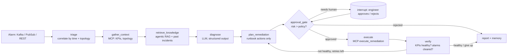

# Telco Assurance Agent

An agentic AI microservice for mobile network operations. It takes a live alarm from a 4G/5G network,
finds the root cause across 5G Core, EPC, IMS and transport, proposes a fix from the operator's runbooks,
waits for a human to approve it, applies it, and checks KPIs to confirm the network recovered.

Runs fully offline on a mocked network (no API key needed). Set one environment variable to use Claude
through the Anthropic API or on Vertex AI.

## What it shows

| Skill | Where |
| --- | --- |
| LangGraph multi-step agent, conditional edges, checkpointed memory | `app/agent/graph.py` |
| Human approval with `interrupt()` / `Command(resume=...)` | `approval_gate` node, `app/agent/service.py` |
| MCP server exposing telecom tools | `app/mcp_server/server.py` |
| MCP client used for every agent tool call (in-process or streamable HTTP) | `app/mcp_client.py` |
| Agentic RAG: query planning, relevance grading, rewrite and retry | `app/rag/retriever.py` |
| Vector store (in-memory numpy or PostgreSQL pgvector) | `app/rag/vectorstore.py` |
| LLM gateway: Claude API, Claude on Vertex AI, offline mock; structured output | `app/llm/gateway.py` |
| Guardrails: no invented nodes, no actions outside the runbook | `diagnose`, `plan_remediation` nodes |
| FastAPI REST service | `app/api.py` |
| PostgreSQL (or SQLite) operational store, read-only SQL tool | `app/db.py` |
| Kafka / Google Pub/Sub alarm consumer | `app/events.py` |
| Traces, Prometheus metrics, JSON logs, optional OpenTelemetry | `app/observability.py` |
| Evaluation harness used as a CI release gate | `eval/run_eval.py` |
| Docker, docker-compose, GitLab CI/CD, GKE and Cloud Run | `Dockerfile`, `docker-compose.yml`, `.gitlab-ci.yml`, `deploy/` |

## Pipeline



## The mock network

18 network functions (gNB, CSR, aggregation router, AMF, SMF, UPF, UDM, NRF, eNB, MME, SGW, HSS, DRA,
P/I/S-CSCF), 20 links with their 3GPP interfaces (N2, N3, N4, N11, S1-MME, S6a, Cx, Mw...), 14 alarms,
13 KPI time series and 6 runbooks. Four faults, each where the loudest alarm is only a symptom:

| Scenario | Trigger alarm | Root cause | Fix |
| --- | --- | --- | --- |
| 5G N2 transport | AMF `SCTP_ASSOC_DOWN` | `csr-blr-01` uplink LOS | `reroute_backhaul_path` |
| 5G user plane | SMF `PFCP_HEARTBEAT_FAIL` | `upf-01` CPU overload | `scale_out_upf` |
| IMS VoLTE/VoNR | P-CSCF `SIP_5XX_HIGH` | Cx Diameter peer on `hss-ims-01` | `failover_diameter_peer` |
| 4G EPC attach | MME `ATTACH_FAILURE_HIGH` | `dra-01` S6a routing | `failover_diameter_peer` |

## Quick start

Needs Python 3.12 or newer.

```bash
python -m venv .venv && . .venv/bin/activate     # Windows PowerShell: py -m venv .venv; .venv\Scripts\Activate.ps1
pip install -r requirements-dev.txt

pytest -q                      # 21 tests
python -m eval.run_eval        # evaluation report -> eval/report.json
python -m scripts.demo         # interactive demo, approve each fix
uvicorn app.api:app --reload   # API docs at http://localhost:8000/docs
```

Use Claude instead of the offline mock:

```bash
export LLM_PROVIDER=anthropic ANTHROPIC_API_KEY=sk-...        # Claude API
# or
export LLM_PROVIDER=vertex VERTEX_PROJECT=my-proj VERTEX_REGION=us-east5   # Claude on Vertex AI
```

On Windows PowerShell: `$env:LLM_PROVIDER="anthropic"; $env:ANTHROPIC_API_KEY="sk-..."`.

Full stack (PostgreSQL + pgvector, Kafka, MCP server, API):

```bash
docker compose up --build
```

To use Claude in the Docker stack, put `LLM_PROVIDER=anthropic` and `ANTHROPIC_API_KEY=sk-...` in a `.env`
file next to `docker-compose.yml` (copy `.env.example`); Compose reads it automatically.

## API walk-through

```bash
# open an incident from the AMF alarm; the agent stops at the approval gate
curl -s -XPOST localhost:8000/incidents -H 'content-type: application/json' \
     -d '{"alarm_id": "ALM-1002"}'
# -> status "awaiting_approval", diagnosis.root_cause_node "csr-blr-01",
#    pending_approval.action "reroute_backhaul_path"

# approve it; the agent executes, re-checks KPIs and closes the incident
curl -s -XPOST localhost:8000/incidents/INC-xxxx/decision -H 'content-type: application/json' \
     -d '{"approved": true, "by": "noc.engineer@operator.com"}'
# -> status "resolved"

curl -s localhost:8000/incidents/INC-xxxx   # full state, RAG attempts, timeline, per-step trace
curl -s localhost:8000/metrics              # Prometheus metrics
curl -s localhost:8000/graph                # the workflow as Mermaid

# a new alarm through the event path (same handler the Kafka / Pub/Sub consumer uses)
curl -s -XPOST localhost:8000/alarms -H 'content-type: application/json' \
     -d '{"id":"ALM-9001","node_id":"upf-01","severity":"major","code":"CPU_OVERLOAD","text":"UPF CPU above 95%","raised_at":"2026-10-21T12:30:00Z"}'
```

## Using the MCP server from other clients

```bash
python -m app.mcp_server.server              # stdio
python -m app.mcp_server.server --http 8001  # streamable HTTP at http://localhost:8001/mcp
```

Claude Desktop (`claude_desktop_config.json`):

```json
{"mcpServers": {"telco-noc": {"command": "python", "args": ["-m", "app.mcp_server.server"],
                              "cwd": "/path/to/telco-assurance-agent"}}}
```

Tools: `get_active_alarms`, `get_alarm`, `get_alarms_in_window`, `get_topology_neighbors`, `query_kpi`,
`search_runbooks`, `run_sql` (single read-only SELECT), `list_actions`, `execute_remediation`
(requires an approval token issued by the approval step).

Point the agent at a remote MCP server with `MCP_SERVER=http://host:8001/mcp`.

## Configuration

See `.env.example`. Main settings:

| Variable | Default | Meaning |
| --- | --- | --- |
| `LLM_PROVIDER` | `mock` | `mock`, `anthropic` or `vertex` |
| `LLM_MODEL` | `claude-sonnet-5-5` | model id passed to the provider |
| `DATABASE_URL` | `sqlite:///:memory:` | `postgresql://...` for PostgreSQL; also enables the Postgres checkpointer |
| `VECTOR_STORE` | in-memory | `pgvector` to store embeddings in PostgreSQL |
| `EVENT_BUS` | `memory` | `kafka` or `pubsub` |
| `MCP_SERVER` | `inproc` | or an MCP streamable-HTTP URL |
| `AUTO_APPROVE_MAX_RISK` | `none` | actions at or below this risk skip the human gate |
| `RESET_DB` | `true` | reseed the mock network on start; set `false` when processes share one database |

## Evaluation

`python -m eval.run_eval` runs 14 golden cases (every alarm in the mock network as the trigger, root
cause or symptom) and reports root-cause accuracy, runbook hit@1, action accuracy, resolution rate,
unsafe-action rate and latency. CI fails the pipeline below 90% accuracy or on any unsafe action.

With the offline mock all 14 cases pass. That checks the pipeline (correlation, retrieval, guardrails,
closed loop), not LLM quality: the mock follows the correlation result. The `agent-eval-claude` CI job
runs the same gate against Claude when `ANTHROPIC_API_KEY` is set.

## What was tested here, and what was not

- Tested: all 21 tests on SQLite and on PostgreSQL 16; the agent talking to the MCP server over real
  streamable HTTP in a separate process; a paused incident approved after an API restart (Postgres
  checkpointer); the Claude provider path with a fake client.
- Written but not run in this environment: pgvector store, Kafka and Pub/Sub consumers, OpenTelemetry
  export, Docker image, GitLab pipeline, GKE and Cloud Run manifests, and calls to the real Claude API.

## Taking it further

- Feed real alarms from an assurance / fault-management system over Kafka and replace the simulator in
  `execute_remediation` with calls to the network orchestrator.
- Swap the hashing embedder for Vertex AI text embeddings.
- Add auth (OAuth) on the MCP server and the API, and per-operator tenancy.
- Grow the golden set from real resolved incidents and track eval scores per release.
